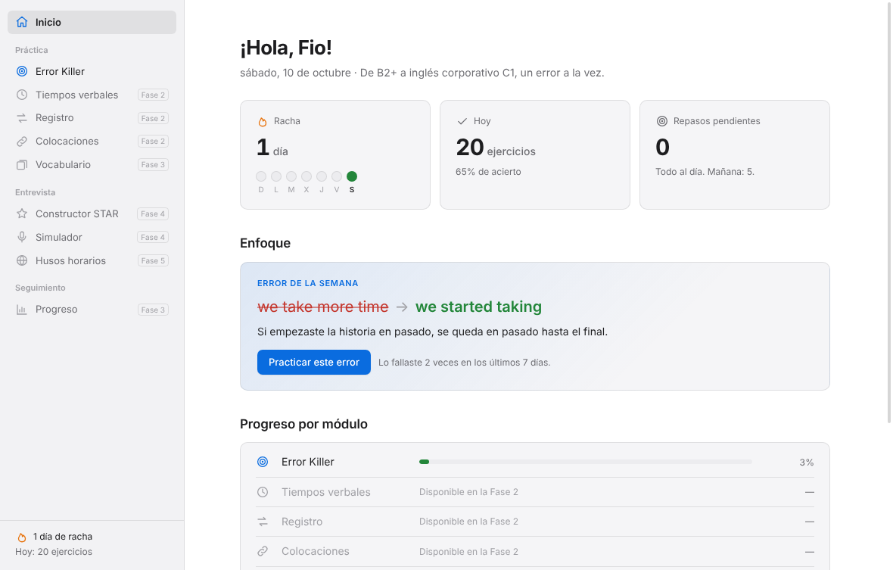
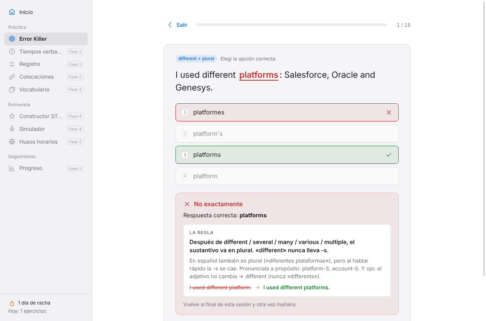

# English Coach

App de escritorio para macOS que me entrena para pasar de inglés **B2+** a **inglés corporativo C1**,
atacando mis errores reales y preparándome para entrevistas (asistente ejecutivo en consultoras
como BCG, logística y comercio exterior).

- Electron + HTML/CSS/JavaScript puro (sin frameworks).
- **100 % offline**: sin internet, sin API keys, sin servidores.
- Interfaz en español; contenido de práctica en inglés.
- Todo mi progreso se guarda en un archivo JSON local.





## Estado por fases

| Fase | Contenido | Estado |
|---|---|---|
| 1 | Esqueleto, navegación, Dashboard, **Error Killer** | ✅ Lista |
| 2 | Tiempos verbales, Registro (call center → oficina), Colocaciones | Pendiente |
| 3 | Vocabulario con repetición espaciada, Progreso | Pendiente |
| 4 | Constructor STAR, Simulador de entrevista | Pendiente |
| 5 | Husos horarios, empaquetado del `.app` | Pendiente |

## Cómo correr la app

Necesitás [Node.js](https://nodejs.org) 20 o superior (recomendado: la versión LTS).

```bash
npm install
npm start
```

Se abre la ventana de **English Coach**. Atajos útiles:

| Atajo | Acción |
|---|---|
| `⌘1` … `⌘9`, `⌘0` | Ir a cada módulo de la barra lateral |
| `1` `2` `3` `4` | Elegir una opción en los ejercicios |
| `↵` (Enter) | Comprobar / Continuar / Empezar sesión |
| `Esc` | Salir de la sesión |

## Cómo generar el `.app` de macOS

```bash
npm run dist       # crea dist/English Coach-<versión>-arm64.dmg y .zip (Apple Silicon)
npm run dist:dir   # solo la carpeta con el .app, sin instalador (más rápido)
```

Hay que correrlo **en una Mac** (desde Linux o Windows el paquete sale roto: no se puede firmar y
el `.zip` pierde los enlaces internos del framework). El resultado queda en `dist/`; para instalar,
abrí el `.dmg` y arrastrá **English Coach** a *Aplicaciones*.

Durante el build vas a ver `firma ad-hoc aplicada`: es una firma local gratuita
(`scripts/after-pack.js`) sin la cual los Mac con Apple Silicon dicen que la app "está dañada".
Como no es un certificado de Apple, la primera vez macOS la bloquea igual: hacé **clic derecho →
Abrir → Abrir** (o en *Ajustes del Sistema → Privacidad y seguridad → Abrir igualmente*). Solo hace
falta una vez.

Si aun así macOS dice que la app "está dañada" (pasa a veces con apps descargadas o copiadas por
AirDrop), quitale la marca de cuarentena y volvé a firmarla:

```bash
xattr -cr "/Applications/English Coach.app"
codesign --force --deep --sign - "/Applications/English Coach.app"
```

## Dónde se guarda mi progreso

En `~/Library/Application Support/English Coach/progress.json`. Para hacer un respaldo, copiá ese
archivo; para empezar de cero, borralo (con la app cerrada).

## Cómo agregar ejercicios nuevos

Todo el contenido vive en archivos JSON dentro de [`content/`](content/). No hace falta tocar
código: editás el JSON, guardás y volvés a abrir la app.

- **En desarrollo** (`npm start`): editá los archivos de `content/` en esta carpeta.
- **En la app instalada**: los JSON están en
  `English Coach.app/Contents/Resources/content/` (clic derecho sobre la app → *Mostrar contenido
  del paquete*). Si actualizás la app, copiá antes tus cambios.

Antes de abrir la app, revisá que no haya errores de formato:

```bash
npm run validate-content
```

Te dice exactamente qué falta o qué está mal (una coma, un `id` repetido, una respuesta que no
coincide con ninguna opción…).

### `content/errors.json` — Error Killer

Cada error tiene su regla y su lista de ejercicios:

```json
{
  "id": "for-ago",
  "title": "for + ago",
  "wrong": "for three years ago",
  "right": "for three years",
  "rule": "«for» y «ago» nunca van juntos.",
  "explanation": "Explicación más larga que aparece cuando fallo.",
  "examples": [
    { "wrong": "I worked there for three years ago.", "right": "I worked there for three years." }
  ],
  "exercises": [ ... ]
}
```

Hay dos tipos de ejercicio:

**Opción múltiple (`mc`)** — `answer` tiene que ser *idéntica* a una de las `options`
(las opciones se mezclan solas cada vez):

```json
{
  "id": "for-ago-17",
  "type": "mc",
  "prompt": "I coordinated imports at Veinsa Motors ___ six months.",
  "options": ["for", "ago", "since", "for ... ago"],
  "answer": "for"
}
```

**Completar (`fill`)** — el `prompt` lleva `___` donde va la respuesta. `answers` es una lista con
todas las respuestas válidas (no importan mayúsculas ni el punto final). `hint` es opcional:

```json
{
  "id": "interested-17",
  "type": "fill",
  "prompt": "I'm ___ in the logistics coordinator role.",
  "hint": "interest",
  "answers": ["interested"]
}
```

Reglas para no romper nada:

1. Cada `id` de ejercicio tiene que ser **único** en todo el archivo (convención: `<error>-<número>`).
2. **No cambies el `id`** de un ejercicio que ya practicaste: el progreso se guarda por `id`.
3. Para un **error nuevo**, agregá un bloque más a la lista `errors` con su propio `id`.
4. Comillas dobles `"` siempre, y coma entre elementos (pero no después del último).

## Cómo funciona la repetición espaciada

| Resultado | Vuelve a aparecer en |
|---|---|
| Fallado | 1 día (y además al final de la sesión, como segundo intento) |
| 1.er acierto | 3 días |
| 2.º acierto | 7 días → ya cuenta como **dominado** |
| 3.er acierto y siguientes | 21 días |

Si fallás un ejercicio dominado, vuelve a empezar desde 1 día. Cada sesión toma primero los
pendientes de hoy y completa hasta 15 con ejercicios nuevos, priorizando los errores que más fallás.

El **error de la semana** del Dashboard es el que más fallaste en los últimos 7 días (si no
fallaste ninguno, rota uno distinto cada semana).

## Estructura del proyecto

```
main.js                 Proceso principal: ventana, lectura/escritura de JSON
preload.js              Puente seguro entre la interfaz y el sistema de archivos
renderer/
  index.html, styles.css
  app.js                Navegación y registro de módulos
  lib/core.js           Lógica pura: fechas, repetición espaciada, racha (con tests)
  lib/store.js          Progreso del usuario
  lib/ui.js             Ayudantes de interfaz e íconos
  modules/              Un archivo por módulo
content/                Ejercicios (JSON editables)
scripts/                Validador de contenido
tests/                  Tests (npm test)
```

## Desarrollo

```bash
npm test                 # tests de la lógica y del contenido
npm run validate-content # valida los JSON de content/
```
